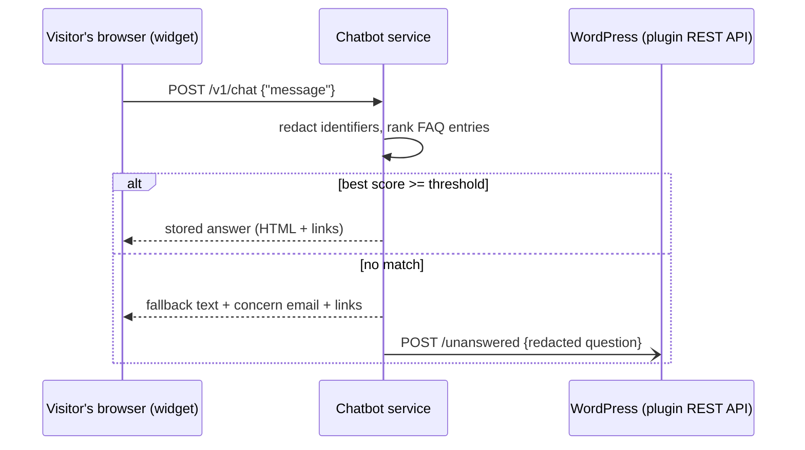
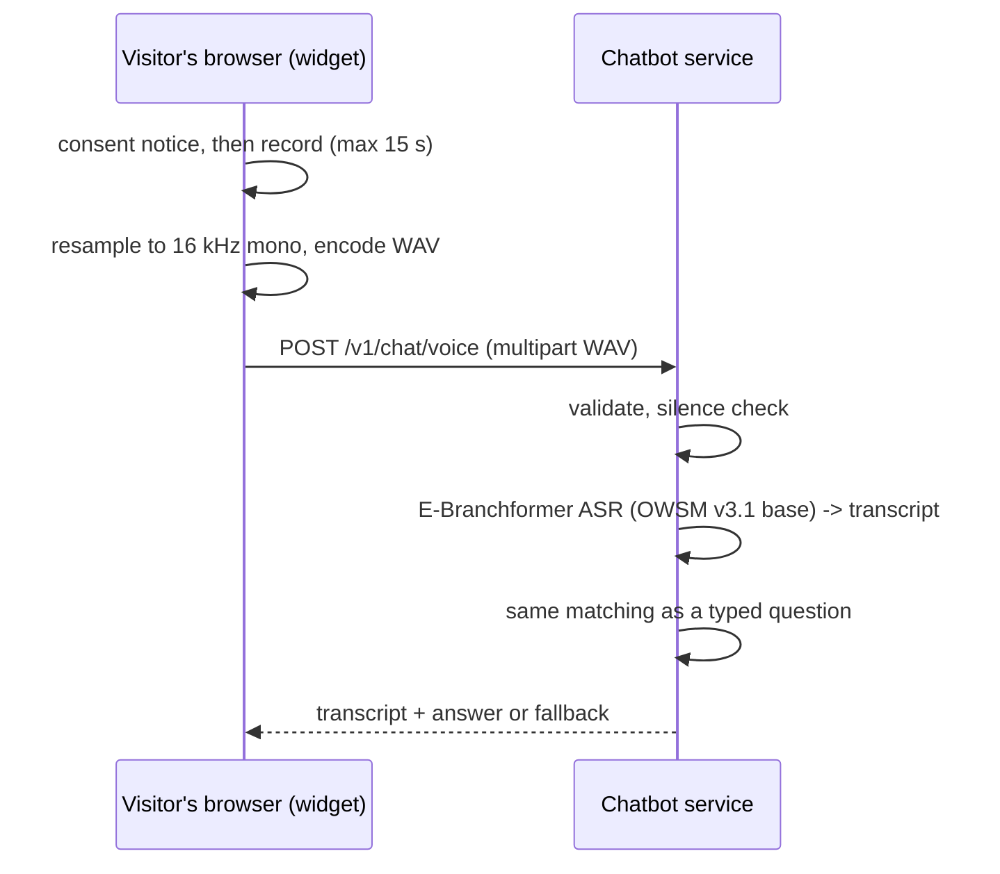

# Architecture

The chatbot is Release 2 of the Organization website SRS (FR-21 to FR-23, NFR-PERF-06, NFR-SAF-04), plus spoken questions transcribed by an E-Branchformer speech model (proposed FR-24, see [srs-change-request.md](srs-change-request.md)).

It has two parts:

| Part | Runs on | Does |
| --- | --- | --- |
| `wordpress-plugin/org-chatbot` | The client's WordPress site (PHP) | FAQ entries as the knowledge base, settings, unanswered-question log, the chat widget, REST endpoints for the service |
| `chatbot-service` | Any Docker host (Python; size it with `scripts/smoke_asr.py`) | FAQ matching, E-Branchformer speech recognition, fallback routing, redaction |

They are separate because the WordPress host cannot run PyTorch, and because the SRS requires that customisation lives in a site-specific plugin rather than core or theme files (NFR-MNT-01).

## Typed question

## Spoken question

The audio never touches disk: it is decoded from the request body into a NumPy array, transcribed, and discarded.

## Knowledge base sync

WordPress builds the knowledge base from published FAQ entries (title = question, content = answer, "other ways people ask" = alternate phrasings, category = concern) and serves it at `GET /wp-json/org-chatbot/v1/kb`. The service:

- loads it at start-up,
- refreshes it every `KB_TTL_SECONDS` (default 60) in the background,
- reloads immediately when WordPress calls `POST /v1/kb/refresh` after any FAQ, category or settings change,
- keeps serving the last good copy if WordPress is unreachable.

That is how an edited answer goes live with no redeployment (FR-23 AC1). Both directions use a shared secret in the `X-Org-Chatbot-Key` header; browsers never call the WordPress endpoints.

## Components inside the service

| Module | Responsibility |
| --- | --- |
| `app/kb.py` | Parse and sanitise the knowledge base (nh3 allow-list), TTL refresh |
| `app/matcher.py` | `EmbeddingMatcher` (sentence-transformers, default) and `LexicalMatcher` (TF-IDF with coverage weighting, fallback and baseline) |
| `app/responder.py` | Small talk, threshold and margin decision, fallback concern routing |
| `app/asr.py` | E-Branchformer speech recognition via ESPnet `Speech2Text`; refuses to enable voice if the encoder is not `EBranchformerEncoder` |
| `app/audio.py` | WAV validation, resampling, silence detection |
| `app/privacy.py` | Redaction of emails, phone and ID numbers, self-introduced names and secrets |
| `app/reporter.py` | Sends redacted unanswered questions to WordPress |
| `app/ratelimit.py` | Per-client limit, keys hashed with a per-process salt, memory only |
| `app/main.py` | FastAPI routes, CORS, timing |

## Design decisions

**Retrieval, not generation.** The SRS rules out open-ended generative chat (OS-06) and requires zero fabricated answers (FR-22, NFR-SAF-04). The service only ever returns an FAQ answer exactly as stored, a fixed fallback, or a fixed small-talk line. The evaluation checks this structurally: every reply text must be one of the approved texts.

**E-Branchformer for speech, not for matching.** E-Branchformer is a speech encoder (parallel self-attention and convolutional-gated MLP branches, merged with depth-wise convolution). It is used where it is strong: turning audio into text. The default checkpoint, `espnet/owsm_v3.1_ebf_base`, is OWSM v3.1 base: 101M parameters, trained on 180k hours of public speech, CC-BY-4.0. Matching text to FAQ entries is a separate, simpler problem handled by sentence embeddings.

**Coverage-weighted lexical matching.** Plain TF-IDF cosine answered 8 of 20 out-of-scope test questions, because one shared word ("member", "event") lifted unrelated questions over the threshold. Multiplying by the IDF-weighted share of the question's words that the FAQ phrasing accounts for fixed that (0 of 20). It remains the fallback when the embedding model cannot load and the baseline for evaluation.

**Redact before matching.** Names, emails and numbers are removed from the question before ranking, so identifiers never influence which answer is chosen and never reach the log.

**WAV built in the browser.** The widget records raw samples with an AudioWorklet and encodes 16 kHz mono PCM WAV itself. This avoids MediaRecorder's per-browser formats (WebM/Opus in Chrome and Firefox, MP4/AAC in Safari) and a server-side ffmpeg dependency, and matches what OWSM was trained on.

**One decode at a time.** ASR runs in a worker thread behind a lock, so concurrent voice questions queue rather than oversubscribe the CPU. Text questions are unaffected. Expect voice throughput of roughly one question per decode time; measure it with `scripts/smoke_asr.py` on the real host.

**Fail closed for voice, fail soft for the page.** If the model is missing, the wrong architecture, or still loading, `/v1/chat/voice` returns 503 and the widget asks the visitor to type. If the service is unreachable, the widget shows the Contact page and email configured in WordPress; the page itself is untouched (NFR-AVL-04).
